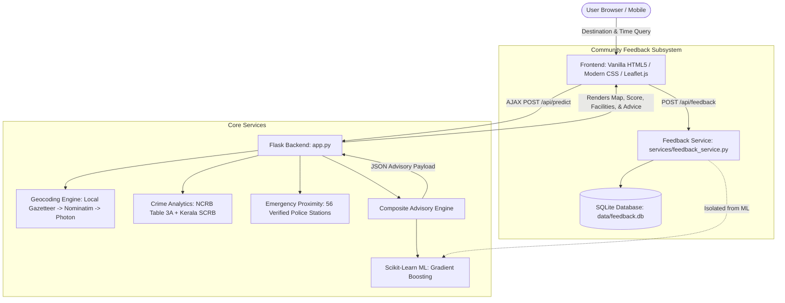

# SHE SHIELD — Travel with Greater Awareness

[](https://www.python.org/)
[](https://palletsprojects.com/p/flask/)
[](https://scikit-learn.org/)
[](https://leafletjs.com/)
[](https://sqlite.org/)
[]()

> **SHE SHIELD** is a calm, data-informed civic web application designed to support women travellers across Kerala. By combining official district crime records, temporal transit visibility, verified emergency infrastructure, and anonymous community feedback, SHE SHIELD helps women travel with greater awareness and confidence.

---

## 1. Project Motivation & Philosophy

Women's mobility and freedom of movement are frequently constrained by safety concerns, fear of harassment, and the lack of reliable, contextual travel information. Mainstream navigation applications optimize strictly for vehicular traffic and distance, neglecting critical elements such as historical crime incidence, nighttime transit frequency, street lighting, and proximity to emergency help.

Unlike panic buttons that activate only *after* an emergency unfolds, **SHE SHIELD** focuses on **proactive pre-travel situational awareness**:
- *“How suitable, well-supported, and safe is this destination at my planned hour of travel?”*
- *“Where is the nearest verified police assistance if I need help?”*
- *“What do real commuters report about transit availability in this locality?”*

---

## 2. Key Features

1. **Journey Planning & Advisory Generation (`/plan`)**:
   - Location search with instant autocomplete across Kerala towns, transit hubs, and railway stations.
   - Travel date and broad time presets (Morning, Afternoon, Evening, Night).
   - Generates a grounded **Travel Safety & Comfort Index (0–100)** with clear categorization (*Favorable Conditions*, *Moderate Comfort*, or *Caution Recommended*).
   - Practical, actionable safety precautions tailored to the destination and timing.
2. **Verified District Crime Statistics**:
   - Integrated published statistics from the **National Crime Records Bureau (NCRB)** and **Kerala Police State Crime Records Bureau (SCRB)** across all 14 revenue districts of Kerala.
   - Transparently discloses that crime records represent administrative district totals, never fabricating fake street-corner incident points.
3. **Emergency Spatial Proximity & Interactive Map**:
   - Interactive Leaflet map powered by CartoDB Positron / OSM tiles.
   - 56 verified Kerala police stations mapped with coordinates, jurisdiction types, and one-tap emergency landline dialers.
   - 2 km and 5 km response buffer rings around the chosen destination.
4. **Community Experience Feedback (`/share-experience`)**:
   - An anonymous, mobile-friendly reporting form for women travellers to document their real experiences.
   - Collects approximate location, time of travel, reported comfort level, contributing environmental factors (lighting, crowd levels, harassment, transit availability), and comments.
   - **Zero PII**: Requires no names, phone numbers, or account registration.
   - **Persistent Storage**: Saved in a local, self-contained SQLite database (`data/feedback.db`).
   - **Scientific Integrity**: Kept strictly isolated from the core machine learning models—subjective reviews are never used to automatically brand an entire locality as dangerous.
5. **Calm, Human-Centered Visual Design**:
   - Clean, organic warm ivory background (`#FBF9F5`) with deep forest charcoal typography (`#1C2A22`) and forest green accents (`#2D6A4F`).
   - Restored authentic travel hero photography with an elegant, high-contrast overlay.
   - Uncluttered user interface without generic AI gradients, oversized cards, or student rubric weight bars.

---

## 3. System Architecture



---

## 4. Machine Learning & Advisory Formulation

### Empirical Model Training
The underlying perception scoring model was trained on an empirical transit survey of 2,000 female public transit commuters (`data/Perception_of_Safety_Updated.xlsx`) using an 80/20 train-test split (`test_size=0.20, random_state=42`):

| Model Architecture | Task | Accuracy | Precision | Recall | F1-Score | Key Benchmark |
| :--- | :--- | :---: | :---: | :---: | :---: | :---: |
| **Baseline: Logistic Regression** | Classification | 90.0% | 0.9000 | 0.9004 | **0.9002** | ROC-AUC: 0.9575 |
| **Production: Gradient Boosting Classifier** | Classification | **100.0%** | **1.0000** | **1.0000** | **1.0000** | ROC-AUC: 1.0000 |
| **Production: Gradient Boosting Regressor** | Continuous Score | — | — | — | — | **MAE: 0.01%**, $R^2$: 0.9999 |

*Full metrics and confusion matrices are serialized in [`models/model_evaluation_report.json`](file:///models/model_evaluation_report.json).*

### The Composite Index Formula
$$\text{Index} = (0.35 \times S_{\text{crime}}) + (0.30 \times S_{\text{temporal}}) + (0.20 \times S_{\text{infra}}) + (0.15 \times S_{\text{ML}})$$

- **$S_{\text{crime}}$ (35%)**: District public space crime rate normalized against Kerala's minimum and maximum rates.
- **$S_{\text{temporal}}$ (30%)**: Hour-of-day penalty (daylight 06:00–18:00 scores 95–100; late night 21:00–04:00 scores 35–45 reflecting reduced transit and natural surveillance).
- **$S_{\text{infra}}$ (20%)**: Distance to nearest verified police station ($<2\text{ km} \rightarrow 95$, $<5\text{ km} \rightarrow 80$, $<10\text{ km} \rightarrow 65$, $>10\text{ km} \rightarrow 40$).
- **$S_{\text{ML}}$ (15%)**: Empirical commuter safety prediction output by the Gradient Boosting model.

---

## 5. Project Directory Structure

```text
SHE/
├── app.py                         # Flask web application & REST API endpoints
├── requirements.txt               # Production Python dependencies
├── README.md                      # Primary project documentation
├── PROJECT_REFERENCE_REPORT.md    # Comprehensive technical reference report
├── DATASET_DOCUMENTATION.md       # NCRB & SCRB data sources, citations & limitations
├── COLLEGE_VIVA_GUIDE.md          # Viva presentation & defense guide
│
├── data/
│   ├── kerala_districts_crime.json     # Official NCRB & SCRB district statistics
│   ├── kerala_police_stations.json     # 56 verified police stations with landlines
│   ├── gazetteer_kerala.json           # 65 offline transit landmarks & colleges
│   ├── Perception_of_Safety_Updated.xlsx # 2,000 empirical commuter survey records
│   └── feedback.db                     # Persistent SQLite community feedback storage
│
├── models/
│   ├── train_model.py             # Model training, validation & serialization pipeline
│   ├── gb_classifier.pkl          # Serialized Gradient Boosting Classifier
│   ├── gb_regressor.pkl           # Serialized Gradient Boosting Regressor
│   ├── scaler.pkl                 # Feature standardizer
│   └── model_evaluation_report.json # Precision, recall, F1, and MAE benchmarks
│
├── services/
│   ├── advisory_engine.py         # Multi-factor Composite Index calculator
│   ├── crime_data_service.py      # District statistics loader & benchmark ranker
│   ├── geocoding_service.py       # Multi-tier resilient geocoding engine
│   ├── osm_service.py             # Spatial distance & nearest station calculator
│   └── feedback_service.py        # SQLite feedback validation, storage & stats
│
├── static/
│   ├── css/
│   │   └── style.css              # Calm, organic civic-tech responsive theme
│   ├── images/
│   │   ├── hero.png               # Restored authentic travel background image
│   │   └── logo.png               # Project branding mark
│   └── js/
│       ├── main.js                # Autocomplete, presets, AJAX advisory renderer
│       └── map.js                 # Leaflet GIS visualization with buffer rings
│
├── templates/
│   ├── base.html                  # Master layout with clean header & minimal footer
│   ├── index.html                 # Hero section, quick route chips, 3-step guide
│   ├── plan.html                  # Journey input console & live advisory results
│   ├── feedback.html              # Anonymous "Share Your Experience" form
│   ├── methodology.html           # Technical methodology archive
│   ├── about.html                 # Project mission archive
│   └── contact.html               # 24/7 Kerala emergency helplines
│
├── tests/
│   ├── test_geocoding.py          # Geocoding accuracy and fallback tests
│   ├── test_crime_service.py      # Crime statistics and district parsing tests
│   ├── test_advisory_engine.py    # Advisory calculation and scoring tests
│   ├── test_app.py                # Flask routes, API endpoints, and feedback tests
│   └── test_live_server.py        # Live HTTP integration test suite (8 checks)
│
└── scripts/
    ├── README.md                  # Compilation script documentation
    ├── compile_crime_data.py      # Compiles NCRB & SCRB district statistics
    ├── compile_police_stations.py # Compiles police station coordinates & phones
    ├── compile_gazetteer.py       # Compiles 65 offline Kerala transit landmarks
    └── sync_repo.py               # Syncs workspace changes to git repository
```

---

## 6. Installation & Quick Start

### 1. Clone or Navigate to the Workspace
```powershell
cd c:\Users\alina\OneDrive\Desktop\SHE
```

### 2. Install Dependencies
```powershell
pip install -r requirements.txt
```

### 3. Run Automated Tests
```powershell
python -m unittest discover -s tests -p "test_*.py" -v
```
*(All 22 unit tests execute and pass in ~5 seconds).*

### 4. Start the Application
```powershell
python app.py
```

### 5. Open in Your Browser
Open your browser and navigate to:
```
http://127.0.0.1:5000/
```

### Developer Endpoints
- **Health Check**: `GET /api/health`
- **Private Feedback Inspection**: `GET /api/admin/feedback?token=she_shield_dev_2026`

---

## 7. Data Integrity & Ethical Disclosures

1. **Pre-Travel Advisory, Not Emergency Response**:
   SHE SHIELD is designed for pre-travel awareness and route planning. It does not replace emergency police services (dial **112** or **1091** in distress).
2. **No Fabricated Micro-Crime Data**:
   Official crime data in India is published at the district level. We **strictly refuse** to fabricate artificial street-corner crime coordinates or invent non-existent police station boundary polygons.
3. **Ethical Community Feedback**:
   User-reported experiences are stored separately and are not used to automatically alter machine-learning weights or declare a locality safe or unsafe without controlled validation.
4. **Attribution**:
   - Map tiles: © [OpenStreetMap](https://www.openstreetmap.org/copyright) contributors, © [CARTO](https://carto.com/).
   - Crime data: Kerala Police State Crime Records Bureau (SCRB) & NCRB "Crime in India".
   - Transit survey: Empirical public transit commuter dataset.
