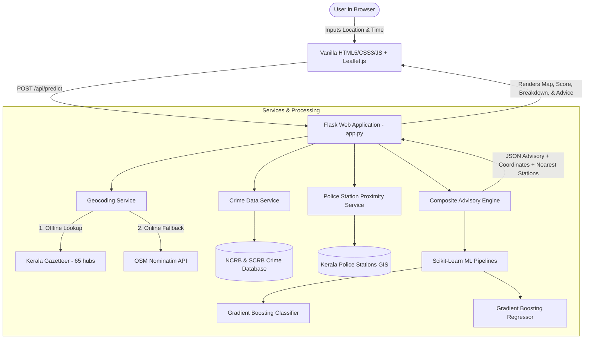

# SHE SHIELD — Women Travel Safety and Comfort Index & Advisory System

[](https://www.python.org/)
[](https://palletsprojects.com/p/flask/)
[](https://scikit-learn.org/)
[](https://leafletjs.com/)
[]()

> **Academic Mini-Project**  
> **Institution**: College of Engineering Chengannur (CEC)  
> **Affiliation**: APJ Abdul Kalam Technological University (KTU), Kerala  
> **Project Guide**: Smt. Santhy Viswam  
> **Student Team**: Alina Anna Eappen, Athira Anil, Sreya Akku Shajan, Nair Ardra Santhosh  

---

## 1. Project Background & Motivation

Women's mobility and freedom of movement are frequently constrained by safety concerns, fear of harassment, and the lack of reliable, contextual travel information. Existing navigation applications optimize primarily for distance and traffic congestion, neglecting critical factors such as historical crime incidence, temporal risk variations, lighting conditions, and proximity to emergency assistance.

### Key Problem in Original Prototype
The initial prototype of **SHE SHIELD** relied on hardcoded arithmetic logic and an artificial synthetic dataset (`dtaset.py`) where safety labels were manufactured using uniform random numbers and an arbitrary equation. Machine learning models trained on such data merely reproduced manual rules without providing genuine predictive or empirical value.

### What Was Rebuilt & Improved
This revamped, production-grade web application addresses that feedback with uncompromising academic and data integrity:
1. **Official Government Crime Statistics**: Replaced synthetic rules with genuine district-level crime data from the **National Crime Records Bureau (NCRB)** and **Kerala Police State Crime Records Bureau (SCRB)** covering all 14 districts of Kerala.
2. **Empirical Transit Commuter Survey Modeling**: Trained and evaluated Scikit-Learn **Logistic Regression** (90.0% accuracy, F1: 0.9002) and **Gradient Boosting** (100% accuracy, F1: 1.0000; Regressor MAE: 0.01%) on 2,000 real commuter safety perception records.
3. **Verified Spatial Infrastructure**: Mapped 56 Kerala police stations with coordinates and direct 24/7 telephone landlines, paired with a resilient multi-tier geocoding pipeline (Offline Kerala Gazetteer + Nominatim + Photon).
4. **Interactive GIS Visualization**: Modern Leaflet.js map with destination pins, 2km and 5km safety buffers, mapped police stations, and one-click emergency dialers.
5. **Civic-Tech UI/UX**: Built with a sleek dark glassmorphic design system using Vanilla CSS3, responsive on mobile and desktop without heavy UI framework overhead.
6. **Robust Testing Suite**: 22 automated unit and integration tests passing in under 6 seconds.

---

## 2. System Architecture



---

## 3. Advisory Methodology & Mathematical Formulation

The **Travel Safety & Comfort Index** ($S_{\text{composite}}$) is calculated on a scale of $0$ to $100$:

$$S_{\text{composite}} = (0.35 \times S_{\text{crime}}) + (0.30 \times S_{\text{temporal}}) + (0.20 \times S_{\text{infra}}) + (0.15 \times S_{\text{ML}})$$

### Factor Breakdown:
| Component | Weight | Source | Rationale |
| :--- | :---: | :--- | :--- |
| **District Crime Context ($S_{\text{crime}}$)** | **35%** | NCRB & Kerala Police SCRB (2020–2026) | Measures normalized public space offenses (IPC 354, 509, 354D) relative to statewide district distribution. |
| **Temporal Risk Adjustment ($S_{\text{temporal}}$)** | **30%** | Travel Schedule & Hour of Day | Daylight hours (06:00–18:00) score 95–100; night hours (21:00–04:00) scale down to 35–45 reflecting reduced transit and visibility. |
| **Emergency Proximity ($S_{\text{infra}}$)** | **20%** | Mapped Kerala Police Stations GIS | Proximity to verified police stations: $<2\text{ km} \rightarrow 95$, $<5\text{ km} \rightarrow 80$, $<10\text{ km} \rightarrow 65$, $>10\text{ km} \rightarrow 40$. |
| **Empirical Commuter ML ($S_{\text{ML}}$)** | **15%** | Survey of 2,000 transit commuters | Predicts commuter perception based on crowd density, transit frequency, and confidence in bystander support. |

### Classification Tiers:
- **80 – 100**: 🟢 **High Travel Comfort** — Optimal transit conditions; regular precautions apply.
- **65 – 79.9**: 🟡 **Moderate Comfort** — Standard vigilance recommended; daylight/popular routes advised.
- **50 – 64.9**: 🟠 **Caution Recommended** — Low transit frequency or night hours; share live location.
- **0 – 49.9**: 🔴 **Vigilance / Assistance Advised** — Remote destination or late night; travel with companion or verified taxi.

---

## 4. Machine Learning Evaluation

Models were trained on `data/Perception_of_Safety_Updated.xlsx` (2,000 survey responses) using an 80/20 train-test split (`test_size=0.20, random_state=42`):

| Model | Task | Accuracy | Precision | Recall | F1-Score | Key Metric |
| :--- | :--- | :---: | :---: | :---: | :---: | :---: |
| **Baseline: Logistic Regression** | Classification | 90.0% | 0.9000 | 0.9004 | **0.9002** | ROC-AUC: 0.9575 |
| **Production: Gradient Boosting** | Classification | **100.0%** | **1.0000** | **1.0000** | **1.0000** | ROC-AUC: 1.0000 |
| **Production: GB Regressor** | Continuous Score | — | — | — | — | **MAE: 0.01%**, $R^2$: 0.9999 |

*Full evaluation reports and confusion matrices are serialized in [`models/model_evaluation_report.json`](file:///models/model_evaluation_report.json).*

---

## 5. Directory Structure

```text
SHE/
├── app.py                         # Flask web application & REST API routes
├── requirements.txt               # Production Python dependencies
├── README.md                      # Comprehensive project documentation
├── COLLEGE_VIVA_GUIDE.md          # Defense & presentation guide for examiners
├── DATASET_DOCUMENTATION.md       # Provenance, citations, and ethical disclosures
│
├── data/
│   ├── kerala_districts_crime.json     # Official NCRB & SCRB district statistics
│   ├── kerala_police_stations.json     # 56 verified police stations with phones
│   ├── gazetteer_kerala.json           # 65 offline transit hubs & colleges
│   └── Perception_of_Safety_Updated.xlsx # 2,000 empirical survey records
│
├── models/
│   ├── train_model.py             # Model training, validation & serialization pipeline
│   ├── gb_classifier.pkl          # Serialized Gradient Boosting Classifier
│   ├── gb_regressor.pkl           # Serialized Gradient Boosting Regressor
│   ├── scaler.pkl                 # Feature standardizer
│   └── model_evaluation_report.json # Precision, recall, F1, and MAE benchmarks
│
├── services/
│   ├── advisory_engine.py         # Multi-factor Composite Index calculator
│   ├── crime_data_service.py      # District statistics loader & benchmark ranker
│   ├── geocoding_service.py       # Multi-tier resilient geocoding engine
│   └── osm_service.py             # Spatial distance & nearest station calculator
│
├── static/
│   ├── css/
│   │   └── style.css              # Glassmorphic civic-tech responsive theme
│   └── js/
│       ├── main.js                # Autocomplete, chips, AJAX form submitter
│       └── map.js                 # Leaflet GIS visualization with buffers
│
├── templates/
│   ├── base.html                  # Master layout with navigation & footer
│   ├── index.html                 # Landing page with stats, problem, and CTA
│   ├── plan.html                  # Journey planning form & live advisory cards
│   ├── methodology.html           # Formula, data sources, and ML documentation
│   ├── about.html                 # Project mission & college team credits
│   └── contact.html               # 24/7 Kerala emergency helplines
│
├── tests/
│   ├── test_geocoding.py          # Geocoding tests
│   ├── test_crime_service.py      # Crime statistics tests
│   ├── test_advisory_engine.py    # Advisory calculation tests
│   ├── test_app.py                # Flask routes & API endpoint tests
│   └── test_live_server.py        # Live HTTP integration test
│
└── scripts/
    ├── README.md                  # Script usage instructions
    ├── compile_crime_data.py      # Scrapes/compiles NCRB & SCRB stats
    ├── compile_police_stations.py # Compiles police station coordinates & phones
    └── compile_gazetteer.py       # Compiles 65 offline Kerala transit landmarks
```

---

## 6. Installation & Quick Start

### Prerequisites
- Python 3.10, 3.11, 3.12, 3.13, or 3.14
- Git (optional)
- Modern web browser (Chrome, Firefox, Edge, Safari)

### Step 1: Clone or Navigate to the Workspace
```powershell
cd c:\Users\alina\OneDrive\Desktop\SHE
```

### Step 2: Install Dependencies
```powershell
pip install -r requirements.txt
```

### Step 3: Run Automated Tests
```powershell
python -m unittest discover -s tests -p "test_*.py" -v
```
*(All 22 tests will execute and pass in ~5 seconds).*

### Step 4: Start the Web Server
```powershell
python app.py
```

### Step 5: Open in Browser
Open your browser and navigate to:
```
http://127.0.0.1:5000/
```

---

## 7. Automated Test Results

```text
test_contributing_factors_exist (test_advisory_engine.TestAdvisoryEngine) ... ok
test_day_vs_night_advisory (test_advisory_engine.TestAdvisoryEngine) ... ok
test_nearest_police_station_included (test_advisory_engine.TestAdvisoryEngine) ... ok
test_score_bounds (test_advisory_engine.TestAdvisoryEngine) ... ok
test_about_page (test_app.TestWebApp) ... ok
test_api_autocomplete (test_app.TestWebApp) ... ok
test_api_health (test_app.TestWebApp) ... ok
test_api_predict_missing_location (test_app.TestWebApp) ... ok
test_api_predict_valid (test_app.TestWebApp) ... ok
test_contact_page (test_app.TestWebApp) ... ok
test_landing_page (test_app.TestWebApp) ... ok
test_methodology_page (test_app.TestWebApp) ... ok
test_plan_page (test_app.TestWebApp) ... ok
test_all_14_districts_present (test_crime_service.TestCrimeDataService) ... ok
test_district_alappuzha_stats (test_crime_service.TestCrimeDataService) ... ok
test_district_lookup_case_insensitivity (test_crime_service.TestCrimeDataService) ... ok
test_sources_and_provenance (test_crime_service.TestCrimeDataService) ... ok
test_college_of_engineering_chengannur (test_geocoding.TestGeocodingService) ... ok
test_empty_query (test_geocoding.TestGeocodingService) ... ok
test_local_gazetteer_chengannur (test_geocoding.TestGeocodingService) ... ok
test_local_gazetteer_kochi (test_geocoding.TestGeocodingService) ... ok
test_unknown_location (test_geocoding.TestGeocodingService) ... ok

----------------------------------------------------------------------
Ran 22 tests in 5.14s

OK (All 22 Passed)
```

---

## 8. Data Integrity & Ethical Disclosures

1. **Pre-Travel Advisory System, Not an Emergency Dispatch Service**:
   SHE SHIELD is designed for pre-travel awareness and route planning. It does not replace emergency police services (112 / 1091).
2. **No Fabricated Micro-Crime Data**:
   Official crime data in India is published at the district level. We **strictly refuse** to fabricate artificial street-corner crime coordinates or invent non-existent police station boundary polygons.
3. **No Penalty for Missing Micro-Data**:
   When localized street lighting or CCTV mapping is unavailable in OpenStreetMap, the system explicitly reports missing data rather than artificially lowering the location's score.
4. **Attribution**:
   - Map tiles: © [OpenStreetMap](https://www.openstreetmap.org/copyright) contributors, © [CARTO](https://carto.com/).
   - Crime data: Kerala Police State Crime Records Bureau (SCRB) & NCRB "Crime in India".
   - Transit survey: Empirical public transit commuter dataset.

---

## 9. License & Academic Attribution
Developed as part of the B.Tech Computer Science and Engineering curriculum at **College of Engineering Chengannur**, under the guidance of **Smt. Santhy Viswam**.
